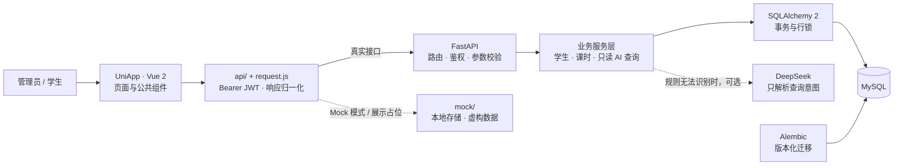

# Jinbi Lesson Management · 课时管理系统

[](https://github.com/desug/jinbi-lesson-management/actions/workflows/ci.yml)

面向培训机构的课时管理项目，采用 **UniApp + Vue 2 / FastAPI / MySQL**，提供管理员和学生两种使用入口。

项目围绕学生信息集中管理、科目课时余额计算和变更记录追溯展开。管理员维护学员与课时，学生查看自己的余额与流水；课时变更同时保存余额和操作记录，减少二者不一致的情况。管理员可以使用自然语言查询课时，常见问法先由本地规则处理，需要时再调用 DeepSeek 解析意图。

公开版本使用虚构学生和演示数据，适合源码阅读、面试展示与隔离环境验证。目前没有公开在线演示地址，也没有附页面截图。真实数据上线前的实现限制见[部署说明](docs/DEPLOYMENT.md#真实业务上线前置条件)。

## 阅读入口

| 文档 | 内容 |
| --- | --- |
| [系统架构](docs/ARCHITECTURE.md) | 分层架构、数据库 ER 图、课时事务时序、AI 与 Mock 边界 |
| [部署说明](docs/DEPLOYMENT.md) | 本地启动、Linux 演示部署、Nginx/systemd 示例、验收与回退 |
| [测试说明](docs/TESTING.md) | 执行命令、隔离策略、用例、MySQL 并发验证、手工验收 |
| [验证记录](docs/VERIFICATION.md) | 本次实际验证的环境、结果和未验证范围 |
| [持续集成](.github/workflows/ci.yml) | MySQL 迁移、后端回归、前端接口与 Mock 回归 |

## 系统概览



实线表示正常 API 数据路径，虚线表示可选服务或演示路径。Nginx、systemd 是部署示例，不属于业务代码内置服务。完整架构和数据关系见[系统架构](docs/ARCHITECTURE.md)。

## 功能与实现状态

| 模块 | 当前公开源码行为 |
| --- | --- |
| 登录与鉴权 | 管理员账号密码登录，bcrypt 校验；学生按已登记手机号登录；JWT 区分角色 |
| 学生管理 | 列表、姓名/手机号/学号搜索、年级与班型筛选、新增、详情、软删除 |
| 年级管理 | 年级汇总与学生列表；只能向更高年级升级 |
| 课时管理 | 按科目加课、扣课、余额与流水；加课金额大于 0 时记录缴费；余额不足拒绝扣课 |
| 学生端 | 查看本人资料、各科目课时和本人的课时记录 |
| 管理员 AI 查询 | 本地规则优先，可选 DeepSeek 意图解析；服务端以固定 ORM 查询返回结果 |
| Mock 演示 | 登录、学生资料/列表/详情、年级和课时操作；设备本地存储，不提供真实认证 |
| 展示占位 | 学生缴费、学生 AI、相册始终使用 Mock；尚无对应学生后端接口 |

一个手机号对应一个学生记录，数据库设置手机号唯一约束。公开后端不支持负余额扣课，即使客户端提交 `allowNegative` 也不会绕过校验。管理员 AI 查询需要后端，Mock 模式没有模拟管理员 AI 接口。退出登录清除客户端凭据，尚无服务端令牌撤销接口。

## 技术栈与设计取舍

| 层级 | 技术与职责 |
| --- | --- |
| 前端 | UniApp、Vue 2、JavaScript、SCSS；HBuilderX 工程，无 npm package.json |
| 接口 | FastAPI、Pydantic；Swagger UI / ReDoc；camelCase 字段别名 |
| 数据 | SQLAlchemy、PyMySQL；请求级 Session、显式事务、MySQL 行锁 |
| 迁移 | Alembic；保留四个既有版本号，扩展迁移版本表容量 |
| 认证 | python-jose JWT、passlib/bcrypt；统一角色检查依赖 |
| AI | OpenAI 兼容客户端，DeepSeek 仅参与意图解析 |
| 验证 | pytest + TestClient、Node 内置测试；GitHub Actions + MySQL 8.4 |

- 路由处理协议、校验与鉴权，服务层处理查询和课时业务规则。
- 加扣课锁住学生和科目，余额、流水及必要的缴费记录在一个事务中提交，失败回滚。
- 课时使用 Decimal / NUMERIC(10,2)，避免持久化浮点累积误差；API 尚未严格拒绝超过两位小数的输入。
- 删除学生采用软删除，保留历史；不等同于数据库物理级联删除。
- AI 不生成 SQL、不持有数据库连接、不调整课时；外部调用仍可能收到问题里的姓名或手机号。

## 目录

```text
frontend/                 # 使用 HBuilderX 打开
  api/ components/ config/ mock/ pages/ static/ utils/
  App.vue main.js manifest.json pages.json
backend/
  app/core/ models/ routers/ schemas/ scripts/ services/ utils/
  alembic/                # 显式执行，不在 API 启动时自动迁移
  tests/
  .env.example requirements.txt requirements-lock.txt requirements-test.txt
  seed.py
README.md
tests/frontend/           # 实际前端 ES 模块与 Mock 契约回归
docs/                     # 架构、部署、测试、验证记录
deploy/                   # Nginx / systemd 配置示例
.github/workflows/ci.yml
```

## 快速运行

### 仅演示前端

1. 用 HBuilderX 导入 `frontend/`，在 `config/index.js` 中设置 `useMock: true`，运行到浏览器。
2. Mock 管理员为 `演示管理员` / `demo-only-password`；学生标识为 `19900000001`、`19900000002`、`19900000003`，仅为虚构数据。
3. 清除本地存储可重置演示数据。联调前恢复 `useMock: false`。

### 前后端联调

准备 Python 3.12、MySQL 8 和 HBuilderX。先建立独立数据库与专用用户，再从仓库根目录执行：

```powershell
python -m venv .venv
.\.venv\Scripts\python.exe -m pip install -r backend/requirements-lock.txt
Copy-Item backend/.env.example backend/.env
# 编辑 backend/.env：设置 MySQL 连接与独立 JWT_SECRET_KEY。
Set-Location backend
..\.venv\Scripts\python.exe -m alembic upgrade head
..\.venv\Scripts\python.exe -m uvicorn app.main:app --reload --host 127.0.0.1 --port 8000
```

前端设置 `useMock: false`、`baseURL: 'http://127.0.0.1:8000'`，运行到浏览器。API 文档在 `/docs`，进程探活在 `/health`。真机、初始化数据和完整部署步骤见[部署说明](docs/DEPLOYMENT.md)。

`requirements.txt` 表达兼容范围；`requirements-lock.txt` 是本次安装并验证的依赖快照，包含测试工具，不是带哈希的跨平台供应链锁文件。

## 自动化测试

在仓库根目录执行：

```powershell
.\.venv\Scripts\python.exe -m pytest -q
node --experimental-vm-modules --test tests/frontend/flows.test.mjs
```

默认后端测试使用一次性 SQLite 内存库，两个 MySQL 专项用例跳过。CI 使用独立 MySQL 8.4，先执行既有迁移，再运行 API、事务回滚和并发扣课测试。前端测试执行实际 ES 模块，替换设备存储和请求接口，不能代替 HBuilderX 编译或页面端到端验收。详见[测试说明](docs/TESTING.md)与[验证记录](docs/VERIFICATION.md)。

## 主要 API

| 方法 | 路径 | 权限 |
| --- | --- | --- |
| POST | `/auth/admin-login`、`/auth/student-login` | 公开登录入口 |
| GET | `/student/profile`、`/student/records` | student |
| GET / POST | `/admin/students` | admin |
| GET / DELETE | `/admin/students/{student_id}` | admin |
| PATCH | `/admin/students/{student_id}/grade` | admin |
| GET | `/admin/students/{student_id}/records`、`/admin/grades`、`/admin/grades/{grade}/students` | admin |
| POST | `/admin/lesson/change`、`/admin/ai-query` | admin |
| GET | `/`、`/health` | 公开进程信息 |

请求、响应与字段以运行后的 `/openapi.json` 和路由源码为准。

## 当前限制与许可

学生手机号登录尚无可靠归属验证或登录限流；CORS 当前开放；部分日志包含业务信息，部分错误包含内部详情。`DEBUG=false` 不会自动消除这些输出。项目未经过生产安全评审、负载测试或真实数据合规评估，未宣称生产可用性或性能指标。

仓库不包含本地 `.env`、业务数据库、原项目 Git 历史或原始学生数据。当前未提供有效署名的 LICENSE，公开可见不等同于授予开源许可；第三方依赖遵循各自许可。
