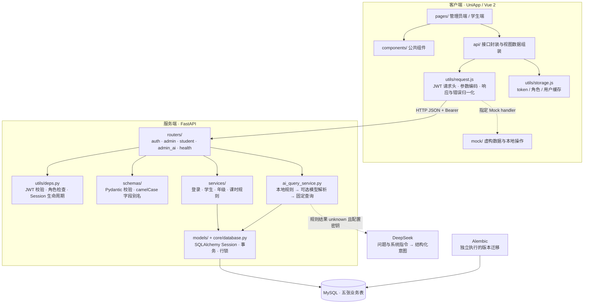
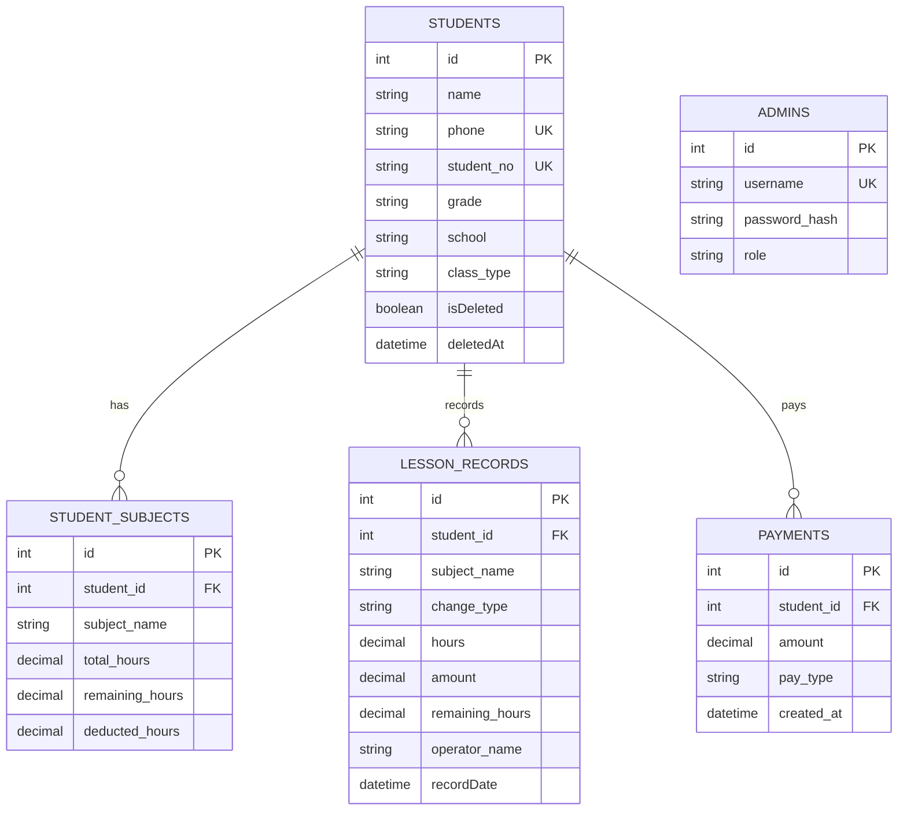
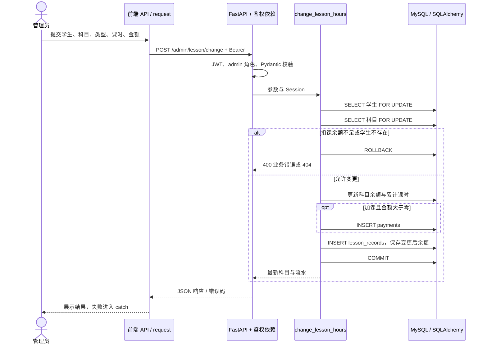
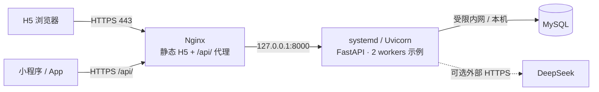

# 系统架构

依据公开仓库实现，并对照本地 UniApp / FastAPI 源码整理。图中区分现有业务实现、可选服务和部署示例。

## 分层与数据路径

| 模块 | 责任与源码 |
| --- | --- |
| 页面和组件 | 交互与渲染：[pages](../frontend/pages/)、[components](../frontend/components/) |
| 前端接口层 | 端点封装、首页与列表数据组装：[api](../frontend/api/)、[transform.js](../frontend/api/transform.js) |
| 请求层 | 参数编码、凭据日志脱敏、401 清理登录态、拒绝业务失败：[request.js](../frontend/utils/request.js) |
| 路由与鉴权 | HTTP 入口、admin/student 角色检查：[routers](../backend/app/routers/)、[deps.py](../backend/app/utils/deps.py) |
| 服务与持久化 | 业务规则、事务与 ORM：[services](../backend/app/services/)、[models](../backend/app/models/) |
| 配置与迁移 | 固定读取 backend/.env，系统环境优先：[config.py](../backend/app/core/config.py)、[alembic](../backend/alembic/) |

每个正常 API 请求获取一个 Session，在依赖退出时关闭。写业务显式提交，业务或 SQLAlchemy 异常显式回滚。当前没有 Redis、消息队列、微服务拆分或支付网关，不将它们画成已实现组件。

## 数据库 ER 图

以下只列关键字段，完整定义见 [models](../backend/app/models/) 与[迁移](../backend/alembic/versions/)。

- 科目表有 `(student_id, subject_name)` 联合唯一约束；课时与金额为 `NUMERIC(10,2)`。
- 流水保存变更后余额快照，按学生/时间及学生/科目设置组合索引。
- 管理员与流水没有数据库外键，流水保存 `operator_name` 文本，不是完整的操作员审计关系。
- 流水与科目也没有直接外键，依靠学生 ID 与科目名关联；图只画实际外键。
- 正常删除接口采用软删除，保留历史。模型中的物理级联删除不是该接口行为。
- 缴费表是记账数据，没有真实支付回调、对账、退款流程，也没有学生缴费查询路由。

## 核心事务：课时调整

核心关系为 `总课时 = 已扣课时 + 剩余课时`。扣课检查余额，加课可新增科目；数据库写入失败时回滚余额、流水和缴费。没有请求幂等键，重复成功提交可能重复记账，前端按钮状态不能替代服务端幂等控制。

MySQL 实现行锁。SQLite 测试可以验证计算和回滚，不能证明 `FOR UPDATE` 的并发行为；[MySQL 专项测试](../backend/tests/test_mysql.py)使用两个独立 Session 同时扣课，验证余额不会透支。

## AI、Mock 与身份边界

AI 先用本地规则识别姓名、科目、班型、年级和低余额等条件，只有意图为 `unknown` 时尝试 DeepSeek。模型输出经结构化解析与意图白名单归一化，最终调用固定 ORM 查询。模型没有数据库连接，不执行模型生成的 SQL，也不调用写操作。无密钥、调用失败或结果不可解析时回退到本地结果或无法识别提示。

外部请求包含管理员问题，可能含个人信息；服务端还会输出查询与结果日志。真实数据使用前需要脱敏与授权评估。自动化测试清空 AI 密钥，不访问第三方服务，也不把规则测试当作模型质量评测。

Mock 使用设备本地存储，不连接 MySQL。`useMock: true` 只让配置了 handler 的接口走 Mock；学生缴费、学生 AI、相册通过 `forceMock` 固定走展示路径。Mock token 不能用于真实 API，Mock 删除也不等同于后端软删除。

JWT 携带角色，student 接口按 token 中的学生 ID 查询，admin 接口只接受管理员。管理员使用 bcrypt 密码校验；学生手机号归属尚未验证。没有 token 撤销列表，也没有在每个请求中重新校验管理员的数据库状态。

## 部署拓扑示例

此拓扑对应 [deploy](../deploy/) 中的配置示例，用于合成数据演示或预发布环境，不表示已经部署到云服务器。H5 与 API 同一 HTTPS 域名，API 只监听回环地址；移动端需配置可访问的 HTTPS API 地址。
